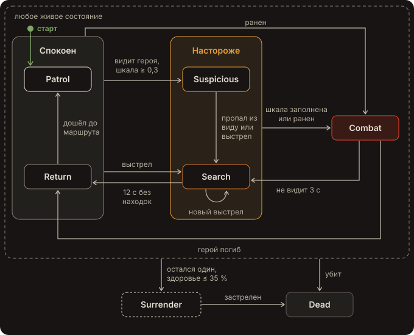

# Рейдер со стелсом — тестовое задание Unity-разработчика (вариант 3)

ИИ рейдера, который патрулирует, замечает героя и ищет его. Unity 6000.3.28f1 (LTS), URP, C#, Input System, AI Navigation.

**Видео:** [все переходы между состояниями, 1:23](https://drive.google.com/file/d/10Vw_7oUbYhJNImgs2yWWI6ER8ksFTivA/view?usp=sharing)

## Как запустить

1. Открыть папку проекта в Unity 6000.3.28f1.
2. Открыть сцену `Assets/Scenes/RaiderDemo.unity` и нажать Play.

Сцену можно пересобрать с нуля: меню **Stealth Raider → Build Demo Scene** (уровень, герой, три рейдера с маршрутами, свет, NavMesh).

## Управление

| Клавиша | Действие |
|---|---|
| WASD | движение |
| Shift | бег |
| Мышь | обзор и прицел |
| ЛКМ | выстрел |
| F1 | включить / выключить отладочную отрисовку |
| R | перезапуск сцены |
| Esc | освободить курсор (клик в окне — захватить снова) |

## Что сделано

- **Патруль по точкам на NavMesh.** Рейдер обходит точки по кругу и стоит у каждой `waypointPause` секунд.
- **Конус зрения с проверкой препятствий.** Угол 110°, дальность 15 м; луч от глаз до трёх точек на теле героя (ноги, грудь, голова), поэтому из-за низкого укрытия видна голова, а контейнер закрывает полностью.
- **Шкала обнаружения.** Пока герой в поле зрения, шкала заполняется: вблизи за 0,5 с, на краю дальности за 4 с, между ними линейно. Вне поля зрения медленно спадает. В поиске заполняется быстрее: рейдер уже настороже.
- **Состояния:** патруль, подозрение, поиск по последней известной позиции, бой, возврат к патрулю. Каждое состояние — отдельный класс; переходы идут через `RaiderBrain.ChangeState` с причиной, которая видна над головой рейдера и пишется в консоль.
- **Выстрел слышен в большом радиусе** (35–40 м) и сразу переводит рейдера в поиск к месту выстрела. Его слышит и игрок: у героя и рейдеров разные звуки выстрела, объёмные — дальний бой звучит тише.
- **Рейдер не убегает.** В бою он сближается до дистанции стрельбы и стреляет; потеряв героя из виду, идёт к последней известной позиции, затем ищет.
- **Сдача:** если рейдер остался один и у него не больше 35 % здоровья, он бросает оружие и поднимает руки.
- **Отладочная отрисовка в игре:** конус зрения (обрезается стенами, цвет — состояние, яркость — шкала), последняя известная позиция с линией к ней, плашка над головой с состоянием, шкалой (белая метка — порог подозрения) и причиной последнего перехода, кольцо слышимости при каждом выстреле, легенда цветов.

## Машина состояний



Стрелка от группы или рамки значит, что переход общий для всех состояний внутри. Цвета — как у отладочных подписей над рейдерами в игре.

| Из | В | Когда |
|---|---|---|
| Патруль, Возврат | Подозрение | герой в поле зрения и шкала ≥ 0,3 |
| Патруль, Возврат, Подозрение, Поиск | Бой | шкала заполнена, или рейдера ранили |
| Подозрение | Поиск | герой пропал из виду на 2,5 с |
| Патруль, Подозрение, Возврат | Поиск | услышал выстрел (в поиске — перезапуск к новой точке) |
| Бой | Поиск | героя не видно 3 с |
| Поиск | Возврат | за 12 с никого не нашёл |
| Бой | Возврат | герой погиб |
| Возврат | Патруль | дошёл до ближайшей точки маршрута |
| Любое | Сдача | остался один и здоровье ≤ 35 % |

Все параметры в `Assets/Settings/RaiderConfig.asset` (ScriptableObject).

## Как читать код

Начать с `RaiderBrain.Update`: каждый кадр рейдер обновляет зрение и шкалу (`Perceive`), затем текущее состояние решает, что делать (`Tick`). Слух и ранения приходят событиями и тоже передаются текущему состоянию (`OnNoise`, `OnDamaged`); поведение по умолчанию — в базовом `RaiderState`, состояния переопределяют его там, где реагируют иначе.

```
Assets/Scripts/Runtime/AI/          RaiderBrain (чувства + машина состояний), RaiderConfig,
                                    DetectionMeter (чистый C#), VisionSensor, RaiderRegistry, RaiderVisual
Assets/Scripts/Runtime/AI/States/   по классу на состояние
Assets/Scripts/Runtime/Combat/      Health, Gun (hitscan), NoiseSystem
Assets/Scripts/Runtime/Player/      HeroController, HeroShooter, ThirdPersonCamera
Assets/Scripts/Runtime/Debugging/   RaiderDebugView, NoiseDebugView, GameHud
Assets/Scripts/Runtime/Environment/ SkySuns — передаёт скайбоксу направления двух солнц
Assets/Art/Shaders/                 TwoSunSky — скайбокс с дымкой и двумя солнцами
Assets/Scripts/Editor/              DemoSceneBuilder — собирает сцену кодом
Assets/Tests/EditMode/              тесты шкалы обнаружения
```

## Допущения

- Герой, рейдеры и окружение из примитивов.
- Нет анимаций и приседания героя. Из звуков — только выстрелы.
- Рейдеры не переговариваются; друг о друге они узнают только по звуку выстрелов.
- HUD — отладочный, на IMGUI.

## Время и инструменты

- Затрачено: 5 часов.
- Нейросети: код написан с Claude (Claude Code): я ставил задачи и принимал решения, проверял и правил результат.
- Готовые ассеты: шрифт Inter (OFL) и звуки выстрелов: Vincent Sevedge (Tabasco), «Gunshot Sounds», OpenGameArt, CC-BY 3.0.
